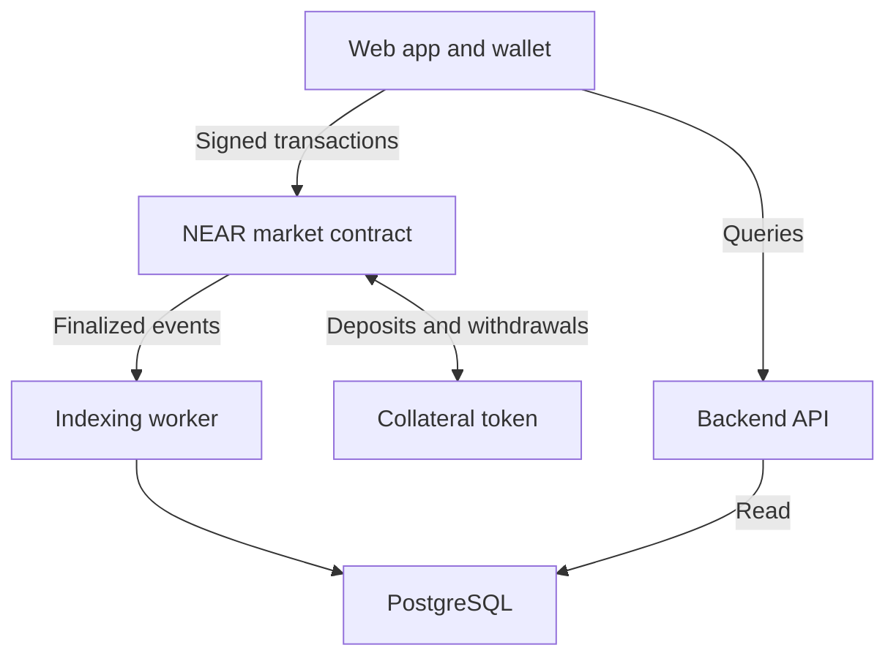

Build the first version as **one repository with a web app, one small backend, and one native NEAR market contract**. The market contract owns the accounting for collateral, YES/NO shares, offers, resolution and redemption. The backend supplies searchable views of confirmed activity.

The first release targets NEAR testnet, binary markets, one six-decimal test collateral token, transaction-authorized offers, and a clearly identified resolver account. It preserves Polymarket’s complete-set economics: one collateral unit backs one YES share plus one NO share. [Polymarket position mechanics](https://docs.polymarket.com/concepts/positions-tokens)

This implementation blueprint builds on the [Polymarket reference for our NEAR prediction market](https://chatgpt.com/space/page_694c701aa0e4819189fc45e6a39b8d5e).

# Recommended stack

| Layer | Choice | Purpose |
| - | - | - |
| Web app | Next.js, React and TypeScript | Market pages, trading and portfolio |
| Styling | Tailwind CSS | Shared responsive interface |
| Wallet integration | NEAR Connect behind a small wallet adapter | Connect accounts and submit transactions |
| Contract | Rust with near-sdk | Authoritative market and balance logic |
| Backend | Node.js, TypeScript and Fastify | Read API and indexing worker |
| Database | PostgreSQL | Searchable projections of contract activity |
| JavaScript workspace | pnpm | Shared packages and scripts |
| Contract workspace | Cargo | Build and test the Rust contracts |
| Tests | Rust unit tests, NEAR Sandbox integration tests, Playwright browser tests | Accounting, cross-contract behaviour and complete user workflows |

NEAR’s current contract guide uses Rust and near-sdk. Its integration-test guide uses near-sandbox with Rust near-api. [Contract guide](https://docs.near.org/smart-contracts/quickstart) · [Integration testing](https://docs.near.org/smart-contracts/testing/integration-test)

The Wallet Selector repository directs new integrations toward its successor connector; that project is currently named NEAR Connect and exposes @hot-labs/near-connect. Keep it behind an adapter and select wallets that support testnet. Pin tested dependency versions in lockfiles when scaffolding. [Wallet Selector guidance](https://github.com/near/wallet-selector) · [NEAR Connect](https://github.com/azbang/near-connect)

# System architecture



Wallet transactions change contract state. The indexing worker reads successful finalized receipt events and updates PostgreSQL. The API serves those projections to the web app. Balances and trade validity remain enforceable through the contract even if a database view is stale.

The API and indexing worker share one backend codebase. They can run as two processes from the same package when deployment requires it; separate market, portfolio and trading microservices are unnecessary for this version.

NEAR cross-contract calls execute asynchronously and do not share a global rollback. Keep both sides of a trade in the same market contract so their accounting updates occur together. Deposit and withdrawal calls cross the token-contract boundary separately. [NEAR cross-contract calls](https://docs.near.org/smart-contracts/anatomy/crosscontract)

# Repository layout

The following paths describe the proposed repository.

```text
near-prediction-market/
  apps/
    web/
      src/
        app/
          page.tsx
          markets/page.tsx
          markets/[marketId]/page.tsx
          portfolio/page.tsx
          funds/page.tsx
          admin/markets/new/page.tsx
          admin/resolve/[marketId]/page.tsx
        features/
          markets/
          trading/
          portfolio/
          collateral/
          resolution/
        components/ui/
        providers/
        lib/
      public/
      package.json

    backend/
      src/
        api/routes/
        indexer/
          source.ts
          ingest.ts
          project.ts
          checkpoint.ts
        db/
          migrations/
          queries/
        config.ts
        server.ts
        worker.ts
      tests/
      package.json

  contracts/
    market/
      src/
        lib.rs
        state.rs
        types.rs
        markets.rs
        balances.rs
        collateral.rs
        positions.rs
        offers.rs
        resolution.rs
        redemption.rs
        math.rs
        storage.rs
        events.rs
        views.rs
      tests/
        collateral_flow.rs
        positions_and_offers.rs
        resolution_and_redemption.rs
        withdrawal_failures.rs
      Cargo.toml

    test-collateral/
      src/lib.rs
      Cargo.toml

  packages/
    client/
      src/
        contract.ts
        transactions.ts
        api.ts
        wallet.ts
        amounts.ts
    types/
      src/
        market.ts
        offer.ts
        position.ts
        events.ts

  tests/
    e2e/
      trade-and-redeem.spec.ts

  scripts/
    deploy-testnet.ts
    seed-demo.ts
    verify-deployment.ts

  deployments/
    testnet.json

  docs/
    architecture.md
    accounting.md
    market-rules.md
    contract-interface.md
    api.md
    demo.md

  Cargo.toml
  Cargo.lock
  package.json
  pnpm-workspace.yaml
  pnpm-lock.yaml
  rust-toolchain.toml
  compose.yaml
  .env.example
  .gitignore
  .github/workflows/ci.yml
  README.md
  HACKATHON.md
```

Cargo manages the Rust contracts; pnpm manages the TypeScript apps and packages. Lockfiles record the tested dependencies. The deployment manifest records actual contract account IDs, network, code hashes and deployment metadata after deployment.

The test-collateral contract is a sandbox and testnet fixture. The market modules compile into **one deployed market contract**.

# Contract modules

| Module | Responsibility |
| - | - |
| lib.rs | Initialize the contract and expose its interface |
| state.rs and types.rs | Define persistent records, identifiers, statuses and public input/output shapes |
| markets.rs | Create markets and enforce immutable terms, deadlines and lifecycle |
| balances.rs | Centralize available/reserved collateral and share accounting |
| collateral.rs | Receive approved-token deposits and manage pending withdrawals and private callbacks |
| positions.rs | Split collateral into complete sets and merge equal YES/NO quantities |
| offers.rs | Create, take and cancel offers; track fills and reservations |
| resolution.rs | Check the resolver’s authority and record the final payout once |
| redemption.rs | Burn current holders’ resolved shares and credit internal collateral |
| math.rs | Checked integer calculations, scales, lot rules and rounding |
| storage.rs | Register accounts, charge or bound storage use, and release unused storage safely |
| events.rs | Emit versioned events for successful state changes |
| views.rs | Read markets, balances, offers, payouts and withdrawal status |

Keep all balance mutations behind the shared accounting helpers. Market, offer and redemption code must not develop independent definitions of available funds. Outcome shares initially live in the market contract’s ledger; an external multi-token interface is a later compatibility feature.

Redemption and withdrawal are separate operations. Redemption turns outcome claims into internal collateral credits. Withdrawal transfers those credits out through the collateral token contract. A verified failed withdrawal restores collateral credit; it never recreates outcome shares.

For deposits, implement ft_on_transfer and verify that the immediate caller is the configured collateral-token contract before crediting sender_id. NEP-141 defines the transfer-and-call receiver flow. [Fungible token standard](https://docs.near.org/primitives/ft/standard)

# Proposed contract interface

These names define our own interface rather than Polymarket-compatible endpoints.

| Area | Methods |
| - | - |
| Registration | storage_deposit; storage_balance_of |
| Market creation | create_market |
| Deposit receiver | ft_on_transfer |
| Complete sets | split_position; merge_positions |
| Trading | create_offer; take_offer; cancel_offer |
| Resolution | resolve_market |
| Redemption | redeem |
| Withdrawals | withdraw; private on_withdraw_complete |
| Reads | get_market; list_markets; get_balances; get_position; get_offer; list_offers; get_withdrawal |

Market creation and resolution are initially restricted to configured accounts, with those roles shown in the interface. The contract enforces authorization; hiding an admin page is only a user-interface choice.

A take_offer call identifies a specific offer and bounded quantity. The contract checks its remaining quantity, price, expiry, market cutoff, caller funds and reservations before transferring any balances. Existing-share trades come first; complementary buy-to-mint and sell-to-merge matching follow later.

Cancellation releases the unfilled reservation. After market closure, users must still be able to release outstanding reservations and redeem eligible shares without waiting for a backend worker. Do not iterate over every user or offer during resolution.

# Core data records

| Record | Essential fields |
| - | - |
| Market | ID, question, immutable rules, YES/NO outcomes, collateral ID, trading cutoff, resolution eligibility time, resolver, invalid-outcome rule, final payout |
| AccountBalance | Account ID, available collateral, reserved collateral, storage credit |
| Position | Market ID, account ID, available YES/NO, reserved YES/NO |
| MarketReserve | Market ID, backing collateral, remaining outcome supplies and payout liabilities |
| Offer | ID, owner, market ID, outcome, buy/sell side, price, quantity, filled quantity, remaining reservation, expiry, status |
| Withdrawal | ID, account, token, amount and execution state |
| ContractEvent | Schema version, event type and payload |
| IndexedEvent | Network, contract, finalized block, receipt ID, event position and parsed payload |
| IndexerCheckpoint | Data-source cursor and last fully committed processing position |

A market can appear OPEN or CLOSED based on its cutoff while remaining unresolved. Finalization records an immutable payout vector. Invalid settlement follows the rule published at market creation.

Use integer base units for money and shares. Rust uses checked integer arithmetic; TypeScript calculations use bigint where appropriate, and JSON represents large integer amounts as decimal strings. PostgreSQL projections use exact numeric columns. Format values for display only at the interface boundary.

Before resolution, splitting and merging preserve equal outstanding YES and NO quantities, including reserved shares. After individual redemptions, remaining payout liabilities determine the required reserve; equal remaining supplies are no longer required. Track per-market backing separately from users’ free collateral.

Round according to one documented policy in math.rs, including repeated partial fills and tiny quantities. Any residual dust stays accounted for. Pending token transfers need explicit reconciliation states so funds cannot be credited or paid twice.

# Web app structure

| Route | User experience |
| - | - |
| / and /markets | Browse and filter markets; see deadlines, status and available trading information |
| /markets/[marketId] | Read exact rules; inspect YES/NO offers; place, accept and cancel offers; see holdings |
| /portfolio | View holdings, open offers, available collateral and claimable payouts |
| /funds | Deposit test collateral, request withdrawals and inspect their status |
| /admin/markets/new | Create a market with complete terms |
| /admin/resolve/[marketId] | Review the fixed resolution rule, enter supporting evidence and submit the payout |

Put reusable business components in features. Keep route files small; they assemble the market list, trade ticket, holdings panel and transaction status components. Shared visual controls live in components/ui.

The client package constructs wallet transactions, serializes amounts, reads contract state and calls the backend. The wallet adapter keeps connector-specific code out of trading components.

Show pending operations separately from confirmed balances. Successful wallet submission is not proof that every relevant receipt succeeded. Refresh authoritative state after confirmation and show indexing lag when the read API is behind.

Use the terms buy shares, sell shares and redeem payout consistently. Display the named resolver and invalid-settlement rule on each market. Test collateral must remain visibly labelled throughout the app.

# Backend structure

The backend has three jobs: ingest chain activity, maintain database projections and serve read queries.

| Backend area | Responsibility |
| - | - |
| indexer/source.ts | Adapt the selected finalized chain-data source |
| indexer/ingest.ts | Validate contract ID and schema, filter successful events and deduplicate them |
| indexer/project.ts | Update market, offer, position and activity views |
| indexer/checkpoint.ts | Save replay progress in the same database transaction as projection updates |
| api/routes | Serve bounded, paginated read endpoints |
| db/migrations | Version tables, exact numeric fields, indexes and uniqueness constraints |
| db/queries | Keep database access separate from transport handlers |

Proposed first-version endpoints:

```text
GET /health
GET /markets
GET /markets/:id
GET /markets/:id/offers
GET /markets/:id/trades
GET /accounts/:accountId/portfolio
GET /accounts/:accountId/activity
GET /accounts/:accountId/withdrawals
```

Trade, cancellation and redemption actions are wallet-signed contract calls. The API does not accept an account ID as authority to spend that account’s funds.

Use a unique event identity such as network, contract, receipt ID and event position. Replaying the same event must leave the projection unchanged. Display balances can be rebuilt from a complete supported event history and checked against contract views. Cache loss must not change actual ownership.

Begin with polling for interface updates. Add push updates when they improve the working trading flow. A future offchain matching engine belongs in a separate backend module only after signature authorization, replay protection and settlement rules have been specified.

# First version and later extensions

| Build first | Add after the core workflow works |
| - | - |
| One test collateral token | Additional collateral and funding routes |
| Binary YES/NO markets | Multi-outcome and negative-risk markets |
| Complete-set split and merge | Complementary matching that mints or merges during trades |
| Existing-share offers, partial fills and cancellations | Signed offchain orders and automatic matching |
| A disclosed resolver account | Oracle and dispute integrations |
| Current-holder redemption and withdrawals | Gas sponsorship and more advanced wallet flows |
| Market list, trading page and portfolio | Analytics and AI-assisted research |

The first version includes real share resale. A user can split collateral, sell YES or NO, and another holder can sell those shares again before resolution. There is no requirement for an automated market maker in this scope; initial demo liquidity comes from explicitly funded test offers.

# Build order and completion checks

| Phase | Build | Completion check |
| - | - | - |
| 1 | Market rules, units, rounding and interface specification | One consistent definition of complete sets, payouts, reservations and invalid settlement |
| 2 | Test collateral, storage registration, deposits, split, merge and withdrawals | Backing is conserved; wrong-token deposits fail; withdrawal failures preserve accounting |
| 3 | Offers, partial fills, cancellation and resale | Three accounts trade; no overspending, overfilling or stale-offer execution |
| 4 | Resolution and redemption | YES, NO and invalid cases pay current holders exactly once |
| 5 | Indexer, read API and frontend | Confirmed chain activity appears in market pages and portfolios |
| 6 | Full testnet demonstration and documentation | A new tester can follow the README and observe each expected result |

The core demonstration is deposit, split, offer, buy, resell, resolve, redeem and withdraw. Add separate cases for merging, invalid settlement, cancellation after cutoff and a failed withdrawal.

Contract unit tests check arithmetic and local transitions. Sandbox integration tests cover token calls, receipts, callbacks, authorization and timing. Browser tests cover one complete user journey. Indexer tests cover duplicates, replay and interrupted processing.

The README should include setup, deployed testnet accounts, test collateral funding, the resolution trust model, and exact “do X, see Y” demo steps. docs/demo.md expands the scenario; HACKATHON.md carries the relevant hackathon guidance and implementation notes.

The first implementation target is contracts/market: establish collateral and outcome accounting, then add offers and resolution. This fixes the contract interface that the backend and frontend will consume.
