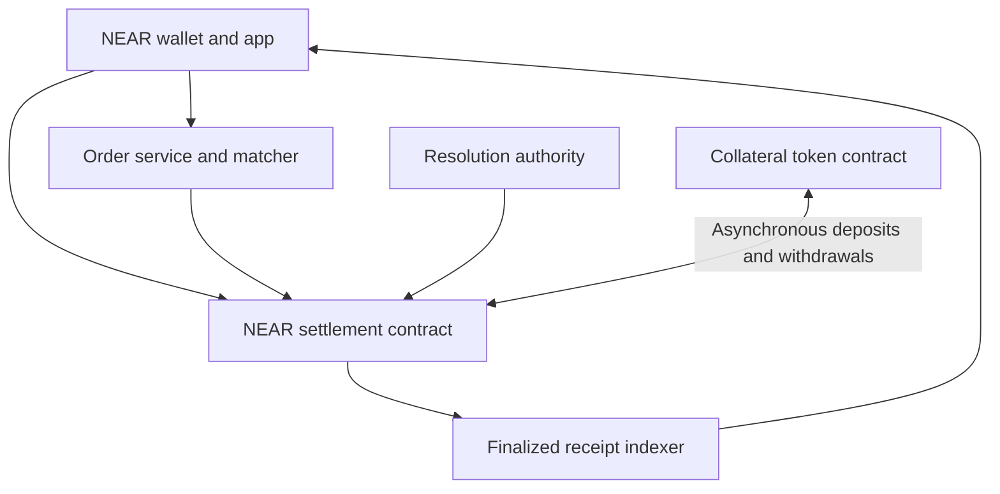

Reference date: **4 November 2026**.

This project will use Polymarket’s prediction-market mechanics as the reference for an independent market on NEAR. The defining mechanism is a fully backed, tradable YES/NO claim with a specified redemption payout. The proposed NEAR implementation below preserves that mechanism while adapting settlement, account authorization, and token handling to NEAR.

The earlier suggestion to distribute a prediction pool among winning stakers is superseded by this share model. Engineering choices below remain a proposed implementation plan. No product contract has been implemented, deployed, or audited as part of this reference.

# Core conclusions

Polymarket separates the economic position, the trading service, and the resolution system. A position is a claim on a specified payout; an order authorizes a proposed exchange; a resolver establishes the final payout. These are separate records and state transitions.

A complete binary set contains one YES and one NO claim backed by one collateral unit. Shares can change owners before resolution. Their redemption value follows the recorded outcome, independently of each holder’s purchase price. [Position mechanics](https://docs.polymarket.com/concepts/positions-tokens)

For our implementation, this means:

- Preserve complete-set backing from the first prototype.

- Support actual ownership transfers and resale.

- Pay current holders at redemption.

- Keep order acceptance, matching, and confirmed settlement separate.

- Specify how ambiguous or unavailable outcomes settle before trading opens.

- Use one native NEAR contract for the balances involved in a trade, so a fill can update them together.

- Treat Polymarket’s APIs, Polygon contracts, collateral, oracle deployments, and liquidity as external infrastructure that our project must replace or deliberately integrate.

# Current Polymarket versions

Current documentation covers several independently versioned systems. Older examples can mix them.

| Name | Meaning |
| - | - |
| CTF | Conditional Tokens outcome balances, with CTF token identifiers |
| CTF Exchange V2 | The current exchange route for CTF positions |
| Polymarket Protocol V2 | PositionManager outcome balances and Binary, NegRisk, and Combinatorial modules |
| ExchangeV3 | Trading settlement for Protocol V2 positions |
| Data API v2 | The reporting API generation, separate from both position systems |
| Unified SDK | The current client interface over hosted Polymarket services |

Both position systems represent outcomes as ERC-1155 balances, but their identifiers and operation targets differ. Protocol V2 routes position operations through Router; existing CTF holdings are not automatically converted. [Position systems](https://docs.polymarket.com/trading/positions/how-positions-work) · [Protocol migration](https://docs.polymarket.com/migrate/polymarket-v2/overview)

The current order guide chooses EIP-712 domain version 2 for CTF books and version 3 for Protocol V2 books. These are signing-domain versions, not API versions. [Order signing](https://docs.polymarket.com/trading/place-orders)

The official changelog records CLOB V2 production activation on 28 April 2026 and retirement of Data API v1 on 2 November 2026. The old accounting snapshot export has no v2 replacement. [Changelog](https://docs.polymarket.com/changelog/predictions)

The current SDK entry point names **@polymarket/client** for TypeScript and **polymarket-client** for Python. Those clients connect to Polymarket; they do not deploy a new NEAR exchange. [SDK guide](https://docs.polymarket.com/getting-started/sdks-apis)

# Collateral and outcome mechanics

## Split merge and redeem

Splitting q collateral units creates q YES and q NO units. Merging equal quantities of both sides removes those claims and releases the corresponding collateral value. Redemption happens against a final payout vector. [Position operations](https://docs.polymarket.com/trading/positions/how-positions-work)

For an ordinary binary market, the proposed payout choices are:

| Final result | Payout per YES | Payout per NO |
| - | -: | -: |
| YES | 1 | 0 |
| NO | 0 | 1 |
| Invalid under the published rule | 0.5 | 0.5 |

The complete set pays one collateral unit in every row. A 50/50 result is a payout to current share holders, not a refund of historical purchase costs. Polymarket documents fractional payouts for binary markets. [Payout rules](https://docs.polymarket.com/concepts/positions-tokens)

For our market, the invalid/timeout rule must be part of the terms before trading. A holder who bought YES for 0.80 and one who bought YES for 0.20 own the same per-share redemption claim. Automatically restoring purchase prices would require reversing intervening trades and would break this model.

## Current Polymarket collateral

The website identifies pUSD as a six-decimal ERC-20 on Polygon backed by USDC. Its current ramp examples specifically use USDC.e. [pUSD documentation](https://docs.polymarket.com/concepts/pusd)

The V2 repository describes an external reserve vault and authorized collateral mint/burn operations: splitting burns the collateral representation, while merging and redeeming mint it. Our native NEAR escrow can preserve the same economic backing without reproducing that wrapper and role architecture. [Collateral design](https://github.com/Polymarket/polymarket-v2-external/blob/main/docs/collateral.md)

For development, use one clearly labeled test collateral token, preferably six decimals for straightforward arithmetic. A production asset remains a separate choice. If native NEAR is chosen instead, every payout is denominated in NEAR; it must not be labeled as a dollar payout.

## Accounting example

The following is an illustrative zero-fee scenario for our proposed ledger:

1. Alice deposits 100 collateral units and creates 100 YES plus 100 NO.

2. Bob deposits 65 and purchases Alice’s 100 YES at 0.65 each.

3. Carol deposits 14 and purchases 20 YES from Bob at 0.70 each.

Before resolution:

| Holder | Free collateral | YES | NO |
| - | -: | -: | -: |
| Alice | 65 | 0 | 100 |
| Bob | 14 | 80 | 0 |
| Carol | 0 | 20 | 0 |

There are 179 deposited units: 79 remain free and 100 back the complete sets. After all redemptions:

| Result | Alice collateral | Bob collateral | Carol collateral | Total |
| - | -: | -: | -: | -: |
| YES | 65 | 94 | 20 | 179 |
| NO | 165 | 14 | 0 | 179 |
| Invalid at 50/50 | 115 | 54 | 10 | 179 |

These totals were checked with exact rational arithmetic. They validate the example, not a smart-contract implementation.

# Market records and lifecycle

An event groups related markets. A market represents a resolvable binary condition, and its outcomes have their own identifiers. Grouping several markets does not make their results mutually exclusive. A listed condition also needs a trading-enabled state before the order book accepts it. [Markets and events](https://docs.polymarket.com/concepts/markets-events)

Our proposed records are:

| Record | Required information |
| - | - |
| Event | ID, title, description, related markets |
| Market | ID, question, collateral asset, YES/NO IDs, terms hash, source specification, trading cutoff, event observation rule, settlement deadline |
| Resolution | Authority, proposal if supported, final payout vector, evidence reference, finalization time |
| Position | Owner, market, outcome, available amount, reserved amount |
| Order | Owner, market/outcome, side, integer price and quantity, remaining quantity, expiry, reservation, status |
| Fill | Unique settlement ID, maker/taker order IDs, quantities, prices, fees, receipt reference, finality state |
| Withdrawal | Unique request ID, owner, amount, destination, pending/completed/failed state |

The question, source, event timing, collateral denomination, and fallback payout should be fixed before opening. Any permitted clarification process must be stated separately and preserve an inspectable history.

Use an explicit lifecycle: draft, open for trading, closed for trading, awaiting resolution, finalized, and redeemable. A market being closed is insufficient evidence that a final payout is available. Redemption must require an actual final result.

Separate the trading cutoff from the time at which the event is measured and the deadline for a result. A closed market may still be unresolved. Once finalized, reject incompatible replacement results and new trading.

# Order books and settlement

Polymarket uses an offchain order book and operator matching with onchain settlement. A market order is implemented as an aggressive limit order. Executable buys consume asks; executable sells consume bids. A displayed midpoint can differ from either executable price. [Prices and order books](https://docs.polymarket.com/concepts/prices-orderbook)

The exchange supports three economic paths:

| Path | Orders or inventory involved | Effect |
| - | - | - |
| Direct trade | BUY YES against SELL YES, or BUY NO against SELL NO | Existing shares move in exchange for collateral |
| Mint during matching | BUY YES against BUY NO | Combined collateral creates a backed complete set |
| Merge during matching | SELL YES against SELL NO | Both claims are removed and collateral is distributed |

For example, compatible purchases at 0.60 for YES and 0.40 for NO fund one complete set. Exact price-improvement and surplus allocation rules still need specification for a new exchange. [Exchange design](https://github.com/Polymarket/polymarket-v2-external/blob/main/docs/exchange.md)

Our first trading implementation can use explicitly split inventory and direct trades. Automatic mint/merge matching can follow without changing the basic economics.

## Orders and fills are different

Polymarket documents resting, immediately matched, and delayed order responses. Trades then move through settlement states, including matched, mined, confirmed, retrying, or failed. An API acknowledgement is not final ownership. GTC, GTD, FOK, FAK, and post-only behavior each impose distinct execution requirements. [Order lifecycle](https://docs.polymarket.com/concepts/order-lifecycle)

For our prototype, begin with a small documented set: fixed-price orders, partial fills if implemented, cancellation of the unfilled remainder, and explicit expiry. A marketable order should have a user-visible worst acceptable price.

The contract must enforce that cumulative fills never exceed the authorized quantity. Cancellation and filling need a deterministic ordering rule based on accepted contract execution. Repeated submission must not create another fill.

## Precision and fees

Current Polymarket order amounts use integer encoding, market-specific ticks, and different maker/taker quantity meanings for buys versus sells. The current guide also distinguishes outcome asset identifiers by protocol version. [Order encoding](https://docs.polymarket.com/trading/place-orders)

Our implementation should define its own integer units, supported ticks, minimum quantity, multiplication width, division rounding, and dust treatment. The frontend must not use floating-point numbers as the authoritative representation of balances, prices, or payouts.

Polymarket currently documents market-dependent taker fees and maker rebates. Its displayed fee formula is shares × rate × price × (1 − price), with rates determined by market category. [Fees](https://docs.polymarket.com/trading/fees)

A zero-fee prototype is a reasonable scope choice. If fees are added, charge them against specified trade proceeds or additional collateral, track them separately, and preserve the complete-set redemption reserve.

# Resolution and trust

The current high-level docs describe UMA proposal/dispute resolution for general prediction markets and Chainlink TWAP-based comparisons for specified up/down markets. The event’s rules determine the source and how ambiguity is treated. [Resolution](https://docs.polymarket.com/concepts/resolution)

The V2 repository documents additional authority: an OracleAggregator with reporter, disputer, arbitrator, operator, and admin roles. It describes admin finalization of unresolved conditions and configurable modules. A description of UMA alone does not establish the full trust model of every current deployment. [Oracle design](https://github.com/Polymarket/polymarket-v2-external/blob/main/docs/oracle.md)

For our prototype, disclose a named resolver and publish its authority before trading. Store the outcome, final payout, and evidence reference. An evidence URL or hash records what was submitted; it does not make the external claim true.

An AI assistant may summarize sources, identify ambiguous questions, or prepare evidence. It should not silently acquire finalization authority.

Before implementation, specify:

- Who can create and list markets.

- Who can propose or finalize an outcome.

- Whether a challenge period exists and who adjudicates disputes.

- What happens if the resolver never responds.

- How invalid results pay current holders.

- Whether administrators can pause, upgrade, or alter unresolved configuration.

- Which actions remain available while trading is paused.

If we later use external price observations, bind the market to the exact provider/feed, units, observation window, timestamps, equality rule, and stale/missing-data behavior. Fetching a price through an API does not itself authenticate it to a smart contract.

# Negative risk and advanced positions

Polymarket’s negative-risk design relates mutually exclusive outcomes: a NO position in one outcome can convert into YES positions in the other outcomes. This requires a correctly defined event and a separate conversion invariant. Augmented outcomes and the changing meaning of Other add further complexity. [Negative risk](https://docs.polymarket.com/concepts/negative-risk)

For our first release, each binary market should remain independent. Sharing an event page is only presentation grouping. Negative-risk conversions, multiple-outcome structures, combinations, and synthetic Other should be introduced only with separate accounting specifications and tests.

An AMM is also a distinct pricing mechanism. Choosing an order book means liquidity comes from actual orders and inventory; the interface must not manufacture executable quotes from a formula or a pool percentage.

# APIs wallets and indexing

Polymarket’s hosted services have different roles:

| Service | Responsibility |
| - | - |
| Gamma | Event and market discovery and metadata |
| CLOB | Prices, order books, order entry and management |
| Data API | Positions, activity and analytics |
| Relayer | Sponsored Polygon wallet transactions |
| Public market stream | Book and market updates |
| Authenticated user stream | Account order and trade updates |

These are interfaces to Polymarket’s existing platform. Our market needs equivalent services derived from our contracts and users. [API surfaces](https://docs.polymarket.com/getting-started/api)

Keep three permissions separate: authenticating an HTTP request, authorizing a financial order, and granting a contract access to assets. An API key is not unrestricted authority to spend a user’s balance. Current Polymarket wallets include Deposit Wallets and legacy wallet types with different signing paths. [Wallets and authentication](https://docs.polymarket.com/trading/wallets-auth)

For our indexer, one canonical balance change should update the projected balance once. Lifecycle events describe the same operation and must not add another credit. Polymarket explicitly separates token transfer events from position-operation context. [Onchain indexing](https://docs.polymarket.com/resources/onchain-position-data)

Build subscriptions around recoverable snapshots. After a disconnect or restart, refresh authoritative state, reconcile outstanding orders and pending receipts, and then resume incremental updates. Distinguish local timestamps, observed events, and finalized onchain outcomes. Preserve unique event/receipt identifiers for deduplication.

# Proposed native NEAR architecture

## Deployment target

Native NEAR uses Rust/Wasm contracts. Aurora is an EVM on NEAR and supports Ethereum tooling; it is a separate implementation path that may preserve Solidity interfaces. Choosing Aurora would not automatically provide Polymarket’s backend, oracle services, liquidity, or permission to reuse its source. [NEAR contract quickstart](https://docs.near.org/smart-contracts/quickstart) · [Aurora architecture](https://doc.aurora.dev/getting-started/what-is-aurora/)

This proposal assumes native NEAR.

## Keep exchange accounting in one contract

NEAR cross-contract calls execute asynchronously and independently. Failure of a later external call does not automatically undo an earlier successful call. [NEAR cross-contract calls](https://docs.near.org/smart-contracts/anatomy/crosscontract)

Therefore, place these balances in one settlement contract:

- User collateral credits, with available and order-reserved components.

- Per-market YES and NO balances, with available and order-reserved components.

- Collateral backing each market’s outstanding claims.

- Order remaining quantities and cancellations.

- Final payout vectors and redemption state.

- Withdrawals and fees.

A fill updates the buyer’s collateral, seller’s collateral, both outcome balances, order reservations, and remaining quantities in one receipt. It should not depend on a separate collateral transfer and a separate outcome transfer both eventually succeeding.

The matcher proposes trades. The contract verifies them. The indexer observes confirmed changes; it does not determine ownership.

## Deposit and withdrawal boundary

For an NEP-141 collateral asset, accept deposits through the token transfer callback. Verify that the immediate caller is the configured collateral contract before trusting sender and amount. NEP-141 defines the transfer/callback and unused-amount refund flow. [Fungible token interface](https://docs.near.org/primitives/ft/standard)

Withdrawal must first debit or reserve the internal balance, then request the external transfer. A private callback records success or restores the credit on confirmed failure. Persist a unique withdrawal ID so retries and interleaved calls cannot duplicate a payout. [Private callbacks](https://docs.near.org/smart-contracts/security/cross-contract-calls/callbacks)

Redemption burns the shares and credits internal collateral atomically; withdrawal is a separate asynchronous operation. A withdrawal failure restores collateral credit, not the shares already redeemed.

Storage and gas funding need their own NEAR budget. They must not be confused with user collateral or market backing. Disclose retained deployment or upgrade keys: their authority is separate from the resolver, collateral issuer, and matcher.

## Outcome representation

A custom internal outcome ledger is sufficient to prove trading economics. NEP-245 is a finalized multi-token interface and is a candidate for exposing outcomes to other applications. It supplies token operations, not prediction-market accounting. Claim compliance only after implementing the required behaviors. [NEP-245](https://github.com/near/NEPs/blob/master/neps/nep-0245.md)

## Authorization sequence

Begin with orders created, accepted, and cancelled through NEAR transactions. That provides a clear account authorization boundary while we prove accounting.

For later offchain orders, define a canonical payload binding the network, contract, schema version, account/key, market, outcome, side, amount, price bound, expiry, unique order ID, and fee limit. Maintain fill counters and enforceable cancellations.

NEP-413 standardizes recipient-bound wallet messages and nonces; it is not a complete exchange authorization system. The contract also needs a valid account-to-key relationship and revocation behavior. NEAR Intents documents an explicit key registry for this purpose. [NEP-413](https://github.com/near/NEPs/blob/master/neps/nep-0413.md) · [Account and key authorization](https://docs.near-intents.org/integration/verifier-contract/account-abstraction)

# Accounting and security acceptance criteria

These are requirements for our implementation.

## Financial conservation

1. Creating q complete sets consumes exactly q collateral units.

2. Before resolution, total YES and NO supplies remain equal within an ordinary binary market.

3. A direct trade moves existing assets without creating claims.

4. Merging consumes equal quantities of both outcomes.

5. Final payout numerators are nonnegative and sum to the fixed denominator.

6. Redemption consumes the holder’s claim before making proceeds available.

7. Repeated redemption cannot pay again.

8. Fees and rounding cannot reduce backing below remaining liabilities.

9. Overflow, tiny quantities, maximum quantities, and repeated partial fills are handled with integer arithmetic.

At a quiescent checkpoint, held collateral must be at least the accounted obligations. Reconcile it against nonoverlapping buckets: user free credits, order-reserved collateral, market backing reserves, separately payable withdrawals, fees, and unallocated surplus. Unsolicited token transfers may create surplus without a user credit. Keep rounding residuals in market reserves until explicitly reclassified. Outcome balances represent claims against those reserves; do not add their nominal sum again as another liability.

During asynchronous transfers, explicitly account for pending operations and assets in transit. A single static balance equality is insufficient if it ignores the execution stage. After individual redemptions, YES and NO supplies can differ; check the remaining weighted payout liabilities instead of continuing to require equal supplies.

## Trading authorization

- Wrong-owner, tampered, expired, revoked, or wrong-domain orders fail.

- Quantity filled never exceeds the authorization.

- Reserved inventory cannot fund another order, withdrawal, or merge.

- Cancellation releases only the unfilled reservation.

- The cancel-versus-fill race has a deterministic result.

- A matcher cannot choose a fill outside either participant’s price limits.

- Repeated settlement IDs and replayed requests do not duplicate fills.

- Finalization closes or invalidates outstanding trading consistently, and users can release remaining reservations without the matcher.

## External calls and operations

- A forged token callback cannot create collateral.

- An unsupported collateral token cannot create credit.

- Failed withdrawals restore the correct collateral credit exactly once; they do not remint redeemed outcome tokens.

- Callback gas exhaustion leaves a recoverable pending record. Ambiguous transfer status never triggers an automatic second payment or an unverified credit restoration.

- External accounts cannot forge callback outcomes.

- Interleaved calls during pending withdrawals preserve all reservations.

- Storage growth and settlement batches have bounded costs.

- Indexer retries do not double-count events.

- A matched or submitted transaction is not shown as finalized ownership until confirmed.

- Unauthorized or repeated resolution cannot change the payout.

These tests should be run against contract behavior and interleaved receipt execution, not only against frontend checks.

# Implementation sequence

## First complete workflow

Build one binary market using one test collateral asset:

1. Two or three users deposit collateral.

2. One user splits a complete set.

3. That user creates an inventory-backed sell offer.

4. Another user accepts the offer.

5. The buyer resells part of the position before resolution.

6. An authorized resolver finalizes a disclosed outcome.

7. Current holders redeem.

8. Users withdraw their collateral.

A separate case should demonstrate merging both sides before resolution. Another should demonstrate the predefined invalid payout. This is the smallest complete workflow that preserves the selected economics.

## Subsequent milestones

| Milestone | Completion evidence |
| - | - |
| Accounting contract | Split, transfer, merge, all payout vectors, and withdrawal failure handling pass conservation tests |
| Basic trading | Real inventory-backed orders, cancellation, fills, and resale work across distinct accounts |
| Order service | Persistent order book, actual liquidity, subscriptions, and recovery reconciliation |
| Signed order optimization | Account/key authorization, domain binding, expiry, revocation, and replay tests |
| Resolution refinement | Explicit proposal/dispute behavior or verified narrow data integration |
| Cross-chain funding | An independently tested funding/withdrawal route with settlement and refund tracking |

Keep initial markets curated, collateral singular, fees simple, and market types binary. Advanced positions and agent features follow a functioning exchange.

The frontend should show question rules, source, resolver, denomination, best bid/ask, available size, maximum cost or minimum proceeds, current positions, and confirmed transaction history. Display estimates and executable offers distinctly.

The remaining product choices before implementation are collateral denomination, initial event category, resolver/fallback policy, deployment target, and administrator powers. The working defaults are native NEAR testnet, a clearly labeled six-decimal test token, curated independent binary questions, and a disclosed prototype resolver.

# Source discrepancies and reuse boundaries

Several official surfaces are not completely synchronized:

- The public order guide gives Protocol V2 the domain name Polymarket CTF Exchange and version 3, while repository exchange prose gives a different name and version. A live integration must verify the deployed domain and SDK behavior before signing. [Public order guide](https://docs.polymarket.com/trading/place-orders) · [Repository exchange guide](https://github.com/Polymarket/polymarket-v2-external/blob/main/docs/exchange.md)

- The pUSD website examples specify USDC.e, while repository collateral design supports configured USDC and USDC.e. Live ramp pause states and the active implementation were not verified. [Website collateral](https://docs.polymarket.com/concepts/pusd) · [Repository collateral](https://github.com/Polymarket/polymarket-v2-external/blob/main/docs/collateral.md)

- Version names refer to different components. Addresses, ABI targets, IDs, allowances, and signing domains must be selected together.

- Current documentation and SDK examples can coexist with older examples. Before coding an integration, pin dependency versions and the exact repository revision used.

The current official Protocol V2 repository identifies its license as **Business Source License 1.1**, with no Additional Use Grant and a stated change date of **27 March 2030** to MIT. The current text grants non-production use under its conditions. Treat production source reuse as a licensing question requiring review; do not assume a permissive production fork is authorized. [Repository license](https://github.com/Polymarket/polymarket-v2-external/blob/main/LICENSE.md)

The reference for our original NEAR design is the economic behavior and documented system boundaries. Polymarket audit claims do not transfer to a rewritten contract. Existing market liquidity and oracle services also do not transfer with a UI or SDK.

This work reviewed the prediction documentation and selected official contract-design sources. It did not verify live deployed bytecode, role assignments, collateral backing balances, or production API execution. The accounting example above was checked mathematically; actual implementation correctness remains to be demonstrated by contract tests.
